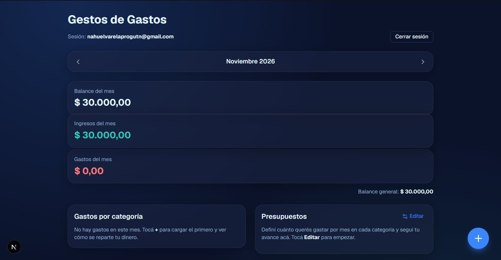
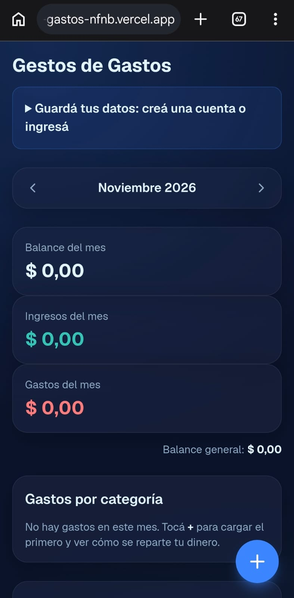

# Gestos de Gastos

Gestor de gastos mensual: registrá ingresos y gastos, filtrá por mes,
definí presupuestos y mirá en qué categorías se va tu plata.

**Demo:** https://gestos-de-gastos-murex.vercel.app/



<p align="center">
  
</p>

## Funcionalidades

- CRUD completo de transacciones (ingresos y gastos)
- 12 categorías con ícono y color propios
- Balance general y balance filtrado por mes
- Gráfico de gastos interactivo con desglose por categoría (SVG + Motion)
- Presupuestos mensuales con alertas visuales por porcentaje
- Uso sin registro (sesión anónima) y cuenta con email, sin perder los datos cargados
- Diseño Mobile First con glassmorphism
- Animaciones con soporte para "reducir movimiento"

## Stack

- **Frontend:** Next.js (App Router), React, TypeScript estricto
- **Estilos:** Tailwind CSS (design tokens) + Sass (CSS Modules y mixins)
- **Animaciones:** Motion
- **Íconos:** Lucide
- **Estado global:** Zustand
- **Backend:** Supabase (PostgreSQL, Auth, Row Level Security)
- **Emails:** Brevo (SMTP)
- **Deploy:** Vercel

## Arquitectura

```
src/
├── app/          # Rutas y páginas
├── components/   # UI (solo presentación)
│   ├── account/      # Registro e inicio de sesión
│   ├── budget/       # Presupuestos
│   ├── charts/       # Gráfico donut
│   ├── summary/      # Tarjetas de resumen y filtro de mes
│   ├── transactions/ # Formulario y lista
│   └── ui/           # Componentes reutilizables (Modal, Button, etc.)
├── hooks/        # Lógica reutilizable
├── lib/          # Cliente de Supabase y registro de íconos
├── services/     # Acceso a datos
├── store/        # Estado global
├── styles/       # Variables y mixins de Sass
├── types/        # Tipos compartidos
└── utils/        # Funciones puras (cálculos, formato)
```

El esquema de base de datos y las políticas RLS están en `supabase/migrations`.

## Decisiones técnicas

- **Cálculos como funciones puras:** los balances y presupuestos se calculan a partir de las transacciones, no se guardan. Así no hay datos que se desincronicen.
- **Montos en centavos:** las sumas se hacen con enteros para evitar errores de coma flotante.
- **Seguridad con RLS:** cada usuario solo puede leer y modificar sus propios datos, validado por la base y no solo por el frontend.
- **Donut hecho a mano con SVG:** sin librerías de gráficos, con animaciones y una leyenda accesible por teclado.

## Correr el proyecto localmente

1. Cloná el repo e instalá dependencias: `npm install`
2. Creá